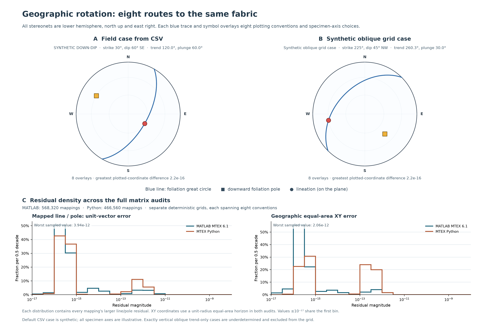

# Fabrica

Fabrica maps measured specimen foliation and lineation directions into a geographic frame for orientation and EBSD analysis. Choose the edition that matches your installation:

| Edition | Status | Start here |
| --- | --- | --- |
| [Legacy MATLAB](matlab/legacy/README.md) | Historical snapshot of the original repository; not validated with current MTEX | `matlab/legacy/` |
| [MATLAB MTEX 6.1.1](matlab/mtex61/README.md) | Updated MATLAB functions, examples, and reproducible rotation tests; tested with MATLAB R2025b and MTEX 6.1.1 | `matlab/mtex61/runFabricaTests.m` |
| [MTEX for Python](python/README.md) | Python port with independent tests, exercised with the installed `mtex==1.0.0` package | `python/fabrica.py` |

**The Python package is not called MTEX 7.** [MTEX's version page](https://mtex-toolbox.github.io/get-started) distinguishes the MATLAB toolbox release from MTEX for Python. The Python port is identified here by the tested package version (`mtex==1.0.0`); it is not a claim of MATLAB MTEX 7 compatibility.

For MATLAB 6.1.1, run `startup_mtex`, add `matlab/mtex61` to the MATLAB path, and call `runFabricaTests`. The [MATLAB guide](matlab/mtex61/README.md) explains right-hand-rule strike, dip, lineation trend or rake, specimen axes, plotting conventions, and EBSD `keepXY`. The [Python guide](python/README.md) covers its corresponding entry points and environment.

The bundled examples and figures use synthetic field measurements. The MATLAB [eight-convention geographic proof](matlab/mtex61/geographic_convention_proof_mtex61.png) shows a foliation great circle, pole, and on-plane lineation. The Python [two-fabric comparison and residual density](python/geographic_matrix_figure.png) compares independently run MATLAB and Python grid audits. Numerical JSON reports accompany both editions; the Python figures also have vector PDFs.

For help with a specimen rotation, open a GitHub issue with the specimen
lineation and foliation-pole axes, field strike/dip and lineation trend or
rake, and the `plottingConvention` you used.

The project is licensed under [GPL-2.0-only](LICENSE).
