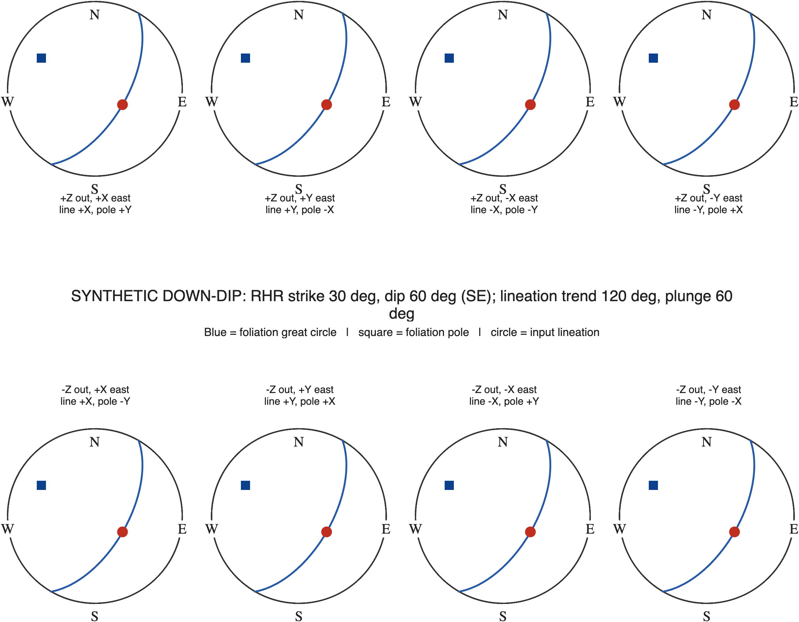

# Fabrica for MATLAB MTEX 6.1.1

Fabrica maps a specimen's foliation and lineation to field measurements, then
uses that rotation to show MTEX orientations and EBSD results in a geographic
reference frame. This edition was tested with **MATLAB R2025b and MTEX
6.1.1**. The separately tested [Python port](../../python/README.md) uses the
installed `mtex==1.0.0` package, whose version number is independent of MATLAB
MTEX.

## Measurements and frames

- Angles are degrees. Trend and dip direction are clockwise from geographic
  north; positive plunge is downward. Strike follows the right-hand rule:
  dip direction = strike + 90°. Dip is 0–90°.
- Rake/pitch is measured in the foliation plane from right-hand strike toward
  down dip, spanning 0–180°. `SDT2or` uses **trend** and solves plunge from the
  plane; `SDP2or` uses **pitch**, including exact vertical lineations whose
  trend is undefined. `FandL2Or` accepts dip direction, dip, and rake.
- A `plottingConvention` locates geographic east, north, and down in MTEX
  coordinates. Pass the **same convention** when constructing and plotting a
  fabric. It controls screen alignment; the specimen-to-field rotation still
  maps physically identified specimen directions to geographic directions.

## Quick start: strike, dip, and lineation trend

Run `startup_mtex`, add this directory to the MATLAB path, then:

```matlab
pc = plottingConvention(zvector,xvector); % east +X, north +Y, down -Z
[fabOr,fabRot,strikeV,poleV,lineV] = SDT2or(15,56,42,pc);
[solvedTrend,solvedPlunge] = V2TP(lineV,pc);
assert(abs(dot(lineV,poleV)) < 1e-10); % lineation lies in the plane
plotGeo(15,56,42,pc);                 % geographic lower hemisphere
```

For this `+Z`-out convention, `SDT2or` and `SDP2or` assume specimen +X is the
lineation and specimen −Y is the downward foliation pole. When `−Z` points out
of the screen, both specimen axes reverse sign. The resulting rotation maps
those source axes onto `lineV` and `poleV`. If the thin section has another
measured alignment, use `geoFab` and supply the actual perpendicular specimen
lineation and pole directions:

```matlab
specimenLine = -xvector;
specimenPole = -yvector;
[fabOr,fabRot,strikeV,poleV,lineV] = ...
    geoFab(15,56,42,specimenLine,specimenPole,pc);
```

`FandL2Or(dipDirection,dip,rake,pc)` deliberately retains its historical
specimen frame: **+X lineation and +Z foliation pole**. Its field vectors use
the same geographic geometry, but its orientation should be plotted using
those +X/+Z source axes. `plotFab` and `plotFabCont` keep that historical
default. For an `SDT2or` or `SDP2or` orientation, pass its actual source axes:

```matlab
plotFab(fabOr,pc,specimenLine,specimenPole);
% plotFabCont(fabOrArray,pc,specimenLine,specimenPole);
```

`plotGeo` uses the returned field vectors directly. `plot_compare` takes
explicit specimen orientations, geographic orientations, Miller indices,
fabric orientation, and convention; it also accepts explicit source axes.

## Rotating orientation and EBSD products

```matlab
sample = makeGeoSample(15,56,42,pc);      % field-only record
rotated = rotTex2Geo(orientations,sample.geo.fabRot);
rotatedODF = rotODFGeo(odf,sample);       % or pass fabRot directly
rotatedEBSD = rotEBSD2Geo(ebsd,sample.geo.fabRot);
```

`rotEBSD2Geo` rotates orientations with MTEX `keepXY`; EBSD map positions stay
in the specimen XY frame. `makeGeoSample` can also receive EBSD objects and
phase names. Its `sample.spec` and `sample.geo` fields retain the source and
rotated products, the convention, the original trend, and the solved plotted
lineation trend/plunge. `V2TP` returns `NaN` trend for a vertical vector.

`geoFab_example.m` demonstrates two specimen-axis alignments mapping to one
field fabric. `Fabric_Example.m` uses MTEX's built-in forsterite data.
`EXAMPLE.m` uses this directory's **synthetic** `example.csv` to exercise the
dip-direction/rake entry point and pole-figure plotting. No external field
data are required for the examples or tests.

## Reproducible checks

From MATLAB with MTEX 6.1.1 installed:

```matlab
startup_mtex
addpath('/path/to/Fabrica/matlab/mtex61')
runFabricaTests
```

The runner checks direction round-trips and all eight cardinal screen
conventions, the three public fabric entry points, specimen-axis plotting
frames, `randFab` rake quadrants, orientation/ODF/EBSD rotation, unchanged
EBSD XY, and a synthetic geographic proof. Its deterministic spherical-grid
audit crosses 120 specimen line/pole pairs, 592 valid field strike/dip/pitch
cases, and eight plotting conventions (**568,320 mappings**). It compares the
mapped line and pole against independent numeric East/North/Down geometry and
records worst cases, quantiles, and complete residual histograms in
`geographic_matrix_report_mtex61.json`. Exactly vertical trend-only cases
that cannot determine an oblique lineation are excluded; pitch-based exact
vertical-line cases are checked separately. Deliberately wrong convention and
pole-side controls produce large errors.

For a visible geographic comparison, run `geographic_convention_proof` in
interactive MATLAB. Its default row in `tests/field_fabric_synthetic.csv` is
synthetic and self-contained. It plots a lower-hemisphere foliation great
circle, downward pole, and in-plane lineation in eight conventions. Supply
your own CSV and sample name to use field measurements; required columns are
`name,strike,dip,dipDir,trend,plunge`. When plotting a custom CSV, give an
explicit output path so the bundled synthetic figure stays intact:

```matlab
geographic_convention_proof('my_field_data.csv','MY_ROW',true, ...
    fullfile(tempdir,'my_geographic_proof.png'))
```

The [Python guide](../../python/README.md) describes the Python port, its 466,560-mapping matrix
audit, and scripts for geographic example and residual-density figures. The
MATLAB and Python audits use different deterministic grids; their JSON reports
are separate validation records.

On the tested macOS MATLAB R2025b installation, MTEX contour figures export
successfully, but `matlab -batch` segfaults during shutdown after a contour
plot. A standalone MTEX `plot(...,'contour')` reproduces the same shutdown
crash without Fabrica. The `plotFabCont` geometry is checked by the numeric
suite; its interactive display still needs a visual check in MATLAB.

## Synthetic geographic and residual figures

This is the MATLAB MTEX 6.1.1 output of the eight-convention proof. Every
panel has the same geographic trace, pole, and lineation despite its different
screen convention and specimen-axis assignment.



The Python figure overlays the eight mappings for two synthetic fabrics and
compares residual distributions from the separate MATLAB and Python grids.


The [Python eight-convention proof](../../python/geographic_convention_proof.png) and
[standalone residual-density plots](../../python/geographic_matrix_density.png) are also
included. The Python figures have vector PDFs, and the numerical checks have
JSON reports beside them.
